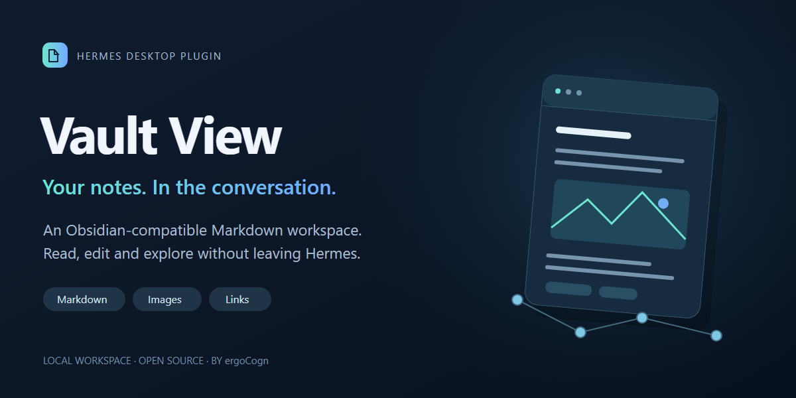
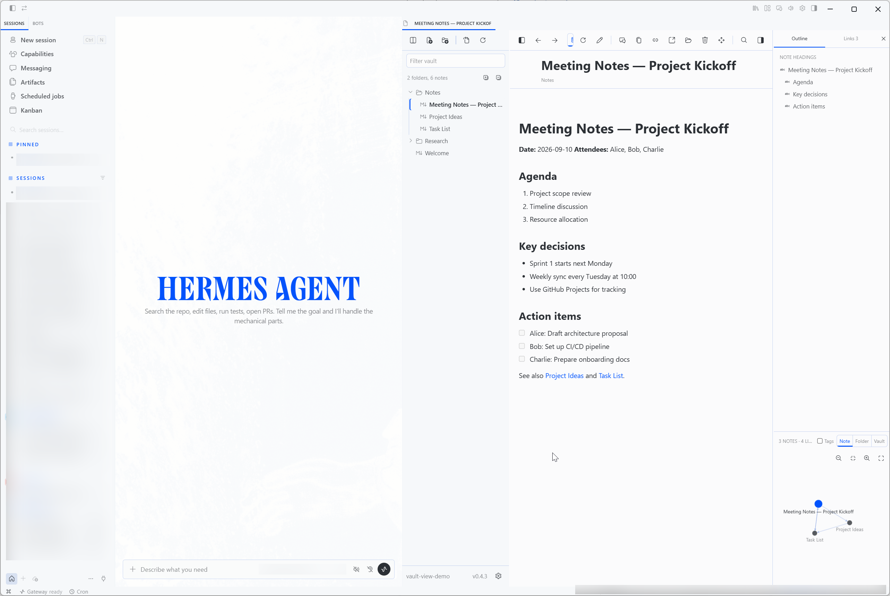
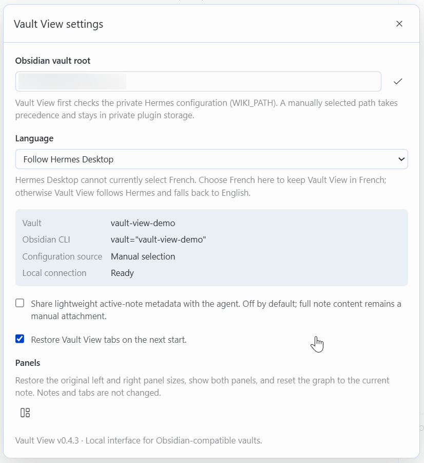

# Vault View

**Votre vault compatible avec Obsidian, directement dans Hermes Desktop.**

[English](README.md) · [Français](README.fr.md)

**Version v0.5.1.**

Vault View intègre votre base de connaissances Markdown à la conversation. Retrouvez une note, demandez à Hermes de la créer ou de la mettre à jour, suivez ses liens et gardez plusieurs notes ouvertes dans un espace conçu pour un vault plutôt que dans un simple aperçu de fichier.

## Nouveautés de la version 0.5.1

- Action SDK publique `::vault-note{vault="MonVault" path="Notes/Revue été.md"}` dans les nouveaux messages assistant. La carte Markdown propose **Ouvrir dans Vault View** et **Télécharger**. L’ouverture crée un nouvel onglet sans remplacer ni enregistrer un autre brouillon ; le téléchargement enregistre la note source vérifiée par Hermes lorsque l’action SDK est disponible.
- Contrôle du vault configuré, du chemin Markdown relatif, du confinement canonique et de la conversation active ; refus des changements de contexte, fichiers absents et liens symboliques sortants. Aucun changement de protocole externe ou du cœur.
- Comportement des workspaces conservé et ajout de la lecture des documents JSON Canvas. La carte a été vérifiée avec Windows Desktop et un gateway Unix ; les autres combinaisons natives restent à vérifier.
- Voir [CHAT-NOTES.md](CHAT-NOTES.md) pour l’activation et la recette native. La carte Preview/Télécharger sert des fichiers, pas la navigation Vault View ; elle ne corrige pas un décalage de chemin client/backend.

## Livraison portable des notes

L’outil facultatif `vault_view_present_note`, côté agent, prépare une note Markdown existante comme pièce jointe Hermes standard `MEDIA:` lorsque l’utilisateur demande explicitement à la voir ou à la télécharger. Android et les autres clients gardent leur carte de fichier habituelle. Si les parties agent et Desktop sont installées et activées ensemble dans un même paquet, Vault View remplace la carte Desktop par **Télécharger** et **Ouvrir dans Vault View**. L’installation directe du seul plugin Desktop conserve l’ancienne action `::vault-note`, mais ne peut pas remplacer la carte produite par l’outil. Le plugin Desktop transmet la racine du vault configuré à son outil dans un réglage privé côté gateway. `WIKI_PATH` reste un repli pour une installation agent seule. Voir [CHAT-NOTES.md](CHAT-NOTES.md).

Un lien `obsidian://` n’est pas une pièce jointe Hermes : il peut être bloqué sur Desktop ou ouvrir une autre cible sur un appareil où Obsidian est configuré différemment. Il ne crée ni les boutons Vault View ni l’aperçu/téléchargement natif. La carte attendue exige que l’agent émette le tag `MEDIA:` renvoyé par l’outil activé.

Pour une livraison portable, insérer le tag MEDIA renvoyé exactement une fois, sans ajouter de directive `::vault-note`. Desktop transforme déjà cette pièce jointe en carte Vault View ; une directive supplémentaire crée une deuxième carte sur Desktop et du texte brut sur les autres clients. Après activation de l’outil, ouvrir une nouvelle conversation ou recharger les outils de la conversation existante. Vault View n’installe et ne modifie aucun skill Obsidian ni autre extension.

Chaque livraison explicite crée une copie privée dans le cache de documents Hermes et conserve les octets exacts. Son nom de téléchargement reprend le titre complet avec translittération ASCII et tirets entre les mots, afin d’éviter la troncature des chemins contenant des espaces. Vault View affiche toujours le nom original. La note source reste intacte. Chaque pièce jointe reçoit un chemin unique permettant à Hermes d’identifier son outil producteur. Les copies sont conservées pour la conversation selon le cycle de vie du cache hôte ; les notes dépassant 32 Mio sont refusées.

Les commandes de navigation de l’agent portent désormais la conversation d’origine. Si vous changez de conversation avant leur arrivée, Vault View les refuse au lieu d’ouvrir la note dans la conversation active. Les anciennes commandes sans identifiant de conversation sont également refusées ; redemandez la note depuis sa conversation d’origine.

## Changements précédents de la version 0.4.8

- Le plugin reste dans sa propre interface : suppression des accès au DOM de la transcription et des onglets Hermes. La sélection des onglets utilise l’API publique de visibilité.
- Traduction en anglais et en français des derniers libellés de copie de code, encadrés, liens, images et contexte de l’agent.
- Mise à jour des images distantes limitée à Vault View et conservation du point d’entrée pour l’installation directe.

## Changements précédents de la version 0.4.7

- Lecture fiable des longues notes et enregistrement vérifié.
- Navigation accélérée avec caches bornés et lecture progressive.
- Mise en forme Markdown pendant l’édition, source préservée, recherche par tags et colonnes adaptatives.
- Aperçus d’images différés, affichage en détail et aperçu des pièces jointes image/texte/code.
- Workspaces facultatifs par conversation, onglets épinglés, annuler/rétablir et journal privé des pannes.

Les miniatures utilisent ffmpeg si disponible, avec repli vers l’image originale. Le transport des fichiers nécessite des utilitaires Unix/WSL. L’ouverture directe dans Obsidian est temporairement masquée ; l’ouverture externe dépend de la configuration hôte/backend. La validation native des lancements Windows/macOS reste incomplète.

Voir [CHANGELOG.md](CHANGELOG.md) et le guide public de contribution pour les IA [AGENTS.md](AGENTS.md).

## Rechercher. Créer. Naviguer.

| Rechercher dans le vault | Créer et modifier | Explorer les liens |
| --- | --- | --- |
| Recherchez des notes, parcourez les dossiers, filtrez les tags et consultez les liens. | Écrivez directement ou demandez à Hermes d’utiliser son intégration Obsidian CLI configurée. | Suivez les wikilinks, utilisez Précédent et Suivant, ouvrez des onglets ou naviguez dans le graphe. |

## Fonctionnalités

- Lecture visuelle et édition Markdown
- Création, renommage, déplacement et suppression de notes et dossiers
- Recherche, explorateur, plan, tags, backlinks, liens sortants et graphe du vault
- Wikilinks, callouts Obsidian et images locales
- Plusieurs onglets avec leur propre historique de navigation
- Citation explicite d’un passage sélectionné vers la conversation active
- Workspaces facultatifs par conversation (désactivés par défaut), avec plusieurs onglets épinglés globaux
- Barres d’outils responsive selon la largeur réelle du panneau Vault View
- Actualisation automatique après une modification par Hermes, Obsidian CLI ou un autre éditeur
- Compatibilité avec les thèmes Hermes clairs et sombres
- Interface en français, en anglais ou suivant automatiquement la langue de Hermes Desktop
- Commandes principalement représentées par des icônes, avec libellés et infobulles traduits

## Fonctionnement avec Hermes

L’agent Hermes continue d’utiliser son intégration Obsidian CLI existante pour les opérations sur les notes. Vault View fournit l’affichage destiné à l’utilisateur et remplace l’aperçu générique pour les tâches liées à Obsidian. Il peut afficher une note, en ouvrir plusieurs simultanément ou rester masqué pour une opération en arrière-plan.

Le `plugin.js` à la racine reste le point d’entrée autonome. `plugin.yaml` contient uniquement les métadonnées du catalogue ; `desktop/plugin.js` est une copie identique pour l’installation depuis le catalogue. Aucun composant Python, outil Agent ou dépendance d’exécution n’est ajouté.

## Installation

Vault View est un Desktop Plugin Hermes autonome. Il ne nécessite ni compilation, ni paquet npm, ni composant Python.

#Le `plugin.js` à la racine reste le point d’entrée autonome. `plugin.yaml` contient uniquement les métadonnées du catalogue ; `desktop/plugin.js` est une copie identique pour l’installation depuis le catalogue. Aucun composant Python, outil Agent ou dépendance d’exécution n’est ajouté.

## Installation en un clic

Ouvrez cette page sur l’ordinateur où Hermes Desktop est installé, puis sélectionnez **Installer dans Hermes Desktop** :

[**Installer Vault View dans Hermes Desktop**](hermes://plugin/install?repo=ergocogn/hermes-desktop-plugin-vault-view)

Hermes demande une confirmation avant l’installation. Si ce lien n’est pas pris en charge par votre version de Hermes Desktop, utilisez l’installation manuelle ci-dessous.

#Le `plugin.js` à la racine reste le point d’entrée autonome. `plugin.yaml` contient uniquement les métadonnées du catalogue ; `desktop/plugin.js` est une copie identique pour l’installation depuis le catalogue. Aucun composant Python, outil Agent ou dépendance d’exécution n’est ajouté.

## Installation manuelle

1. Copiez ce dépôt dans le dossier actif des plugins Hermes Desktop sous le nom `vault-view`.
2. Vérifiez que le point d’entrée est `$HERMES_HOME/desktop-plugins/vault-view/plugin.js`.
3. Rechargez les Desktop Plugins dans les paramètres Hermes.
4. Activez **Vault View**.

Utilisez le dossier indiqué par Hermes Desktop. L’application Desktop et son backend peuvent utiliser des emplacements différents, notamment avec WSL ou une machine virtuelle.

## Configuration

Vault View recherche automatiquement le vault déjà configuré dans Hermes par `WIKI_PATH`. Si aucun vault `.obsidian` valide n’est trouvé, sélectionnez sa racine dans les paramètres.

Le réglage de langue propose **Suivre Hermes Desktop**, **English** et **Français**. Le même panneau permet de restaurer les onglets, d’activer les workspaces par conversation, de réinitialiser les panneaux et de régler séparément le partage de métadonnées sur la note active, les indications à l’agent et les images distantes. Les workspaces par conversation sont désactivés par défaut ; une fois activés, chaque conversation conserve ses onglets ouverts ou fermés et ses brouillons, tandis que les onglets épinglés restent visibles partout. Les options de partage et de réseau sont indépendantes et désactivées par défaut.

La sélection d’un texte dans une note active l’action de citation dans la barre supérieure et ajoute **Copier la sélection** et **Citer la sélection dans la conversation** au menu contextuel de la note. La citation résulte toujours d’une action explicite, cible la conversation Hermes actuellement active et la sélection n’est jamais stockée.

## Confidentialité

- Les fichiers du vault restent sur le système de fichiers local configuré.
- Aucun jeton, identifiant, chemin personnel ou contenu de note n’est intégré au plugin.
- Le contenu complet d’une note n’est jamais joint automatiquement à l’agent.
- Le partage facultatif de la note active est désactivé par défaut et ne transmet que des métadonnées légères.
- Les images distantes sont bloquées par défaut. Leur activation envoie des requêtes à leurs fournisseurs, sans référent. Ouvrir explicitement un lien web contacte son site via le composant isolé du SDK ou le navigateur externe.
- Les indications de navigation à l’agent sont une option indépendante et traduite.
- Le chemin du vault est conservé dans le stockage local privé de Vault View et dans un réglage privé côté gateway pour son outil de livraison facultatif. Une livraison explicite crée une copie conservée dans le cache de documents hôte. Ces données locales sont exclues du paquet.

Les captures utilisent un vault de démonstration synthétique. Elles ne contiennent aucun chemin personnel, aucune conversation privée ni note réelle ; leurs métadonnées PNG ont été supprimées.

## Compatibilité

- Hermes Desktop >=0.21.5 avec prise en charge des Desktop Plugins
- Vault Markdown local compatible avec Obsidian
- Transport Unix Linux ou macOS. Windows Desktop peut utiliser un backend Unix hébergé dans WSL ; les gateways Windows natifs ne sont pas pris en charge par le transport POSIX.

## Support et contributions

Utilisez les [GitHub Issues](https://github.com/ergocogn/hermes-desktop-plugin-vault-view/issues) pour le support, les bugs et les propositions. Consultez [CONTRIBUTING.md](CONTRIBUTING.md), [SUPPORT.md](SUPPORT.md) et [SECURITY.md](SECURITY.md) avant de partager des journaux ou des captures.

## Projet indépendant

Vault View est un projet communautaire indépendant publié par ergoCogn sàrl. Il n’est ni affilié, ni sponsorisé, ni approuvé par Dynalist Inc., l’éditeur d’Obsidian, ou par Nous Research, le mainteneur d’Hermes. Les noms de produits servent uniquement à décrire la compatibilité.

## Licence

[MIT](LICENSE) © 2026 ergoCogn sàrl
