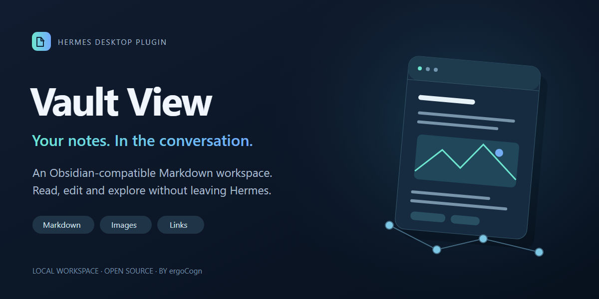
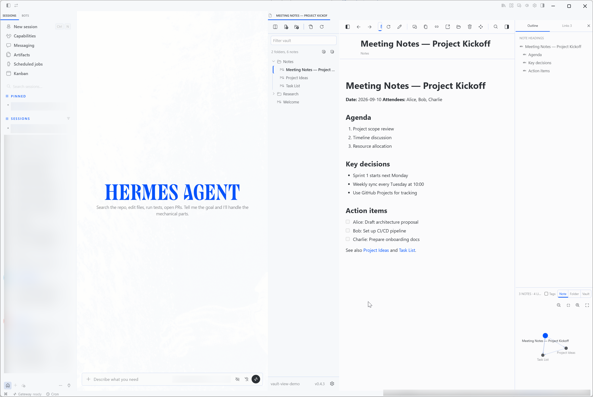
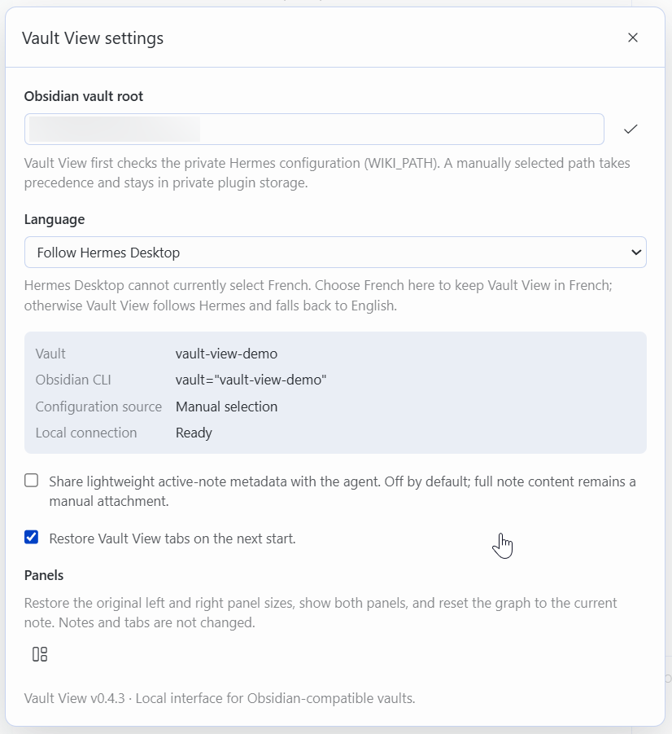

# Vault View

**Your Obsidian-compatible vault, directly inside Hermes Desktop.**

[English](README.md) · [Français](README.fr.md)

**Local candidate v0.5.1 — not a published release.**

Vault View brings your Markdown knowledge base into the conversation. Find a note, ask Hermes to create or update it, follow its links, and keep several notes open in a workspace designed for a vault—not a generic file preview.

## What is new in 0.5.1 (local candidate)

- Add the public SDK `::vault-note{vault="MyVault" path="Notes/Review été.md"}` action to new assistant messages. The Markdown file card offers **Open in Vault View** and **Download**. Opening creates a fresh tab without replacing or saving another draft; downloading saves the validated source file through Hermes when its SDK download action is available.
- Validate the configured vault, relative Markdown path, canonical containment and focused conversation; refuse stale context, missing files and escaping symlinks. No external protocol or core-policy changes.
- Keep workspace behavior and add read-only JSON Canvas viewing. The tested Windows Desktop / Unix gateway combination supports the new file card; other native host/backend combinations remain unverified.
- See [CHAT-NOTES.md](CHAT-NOTES.md) for activation, compatibility and native acceptance. The standard Preview/Download card serves files, not Vault View navigation, and does not repair a client/backend path mismatch.

## Portable note delivery (unreleased local candidate)

The optional agent-side `vault_view_present_note` tool prepares an existing Markdown note as a standard Hermes `MEDIA:` file attachment when the user explicitly asks to see or download it. Android and other clients keep their normal file card. If the agent and Desktop halves are installed together as one enabled package, Vault View replaces the Desktop card with **Download** and **Open in Vault View**. A direct Desktop-only installation continues to support the older `::vault-note` action but cannot claim the tool's file card. The Desktop plugin shares its configured vault root with the agent tool through a private gateway-side file. For an agent-only install, `WIKI_PATH` remains available as a fallback. See [CHAT-NOTES.md](CHAT-NOTES.md).

An `obsidian://` link is not a Hermes file attachment: Desktop may block it, and another device may resolve it to a different target. It creates neither the Vault View buttons nor native preview/download. The expected card requires the agent to emit the `MEDIA:` tag returned by the enabled tool.

A `::vault-note` directive alone is a Desktop card, not a file attachment. After enabling the agent tool, use a new conversation or reload the tools in the existing one before requesting a portable file card.

For portable delivery, include the returned MEDIA tag exactly once and do not add a `::vault-note` directive. Desktop already upgrades that attachment into the Vault View card; the extra directive creates a duplicate card on Desktop and raw text on other clients. Vault View does not install or modify an Obsidian skill or another extension.

Explicit file delivery creates a private snapshot under Hermes's document cache, retaining the exact bytes. Its download filename contains the complete title with hyphens between words and ASCII transliteration, avoiding MEDIA clients that truncate paths at whitespace. Vault View still displays the original note name. The source note is unchanged. A unique attachment path lets Hermes identify Vault View as its producer even after another tool searched for the source note. Snapshots remain available for conversation attachments under the host cache lifecycle; notes over 32 MiB are rejected.

Agent navigation commands now carry their originating conversation. If you switch conversations before a command arrives, Vault View rejects it instead of opening the note in the active conversation. Older commands without a conversation identifier are also rejected; request the note again from its original conversation.

## Previous changes in 0.4.8

- Keep the plugin inside its own UI root: remove Hermes transcript and tab-strip DOM access. Workspace tab selection uses the public SDK visibility atom.
- Complete English and French labels for code copying, callouts, links, images and agent context.
- Keep remote-image updates inside Vault View and preserve the plugin's direct-install entry point.

## Previous changes in 0.4.7

- SDK-sandboxed web previews, with Hermes >=0.21.5 required.
- Separate agent navigation guidance and remote-image settings, both off by default.
- Complete English/French errors, dialogs, bridge messages and formatting defaults.

- Reliable chunked reading and verified saves for long notes.
- Faster navigation with bounded, revision-aware caches and progressive reading.
- Live Markdown styling, source preservation, tag search and responsive sidebars.
- Lazy image previews, a detail viewer, and image/text/code attachment previews.
- Optional conversation-specific workspaces, pinned tabs, editing undo/redo and private incident diagnostics.

Raster thumbnails use ffmpeg when available; original images remain available as a fallback. The filesystem transport requires Unix/WSL shell utilities. Direct Obsidian opening is temporarily hidden; external application opening depends on the host/backend configuration. Native Windows/macOS launch validation remains incomplete.

See [CHANGELOG.md](CHANGELOG.md) for the complete changes and [AGENTS.md](AGENTS.md) for the public AI contribution guide.

## Find. Create. Navigate.

| Search the vault | Create and edit | Explore connections |
| --- | --- | --- |
| Search notes, browse folders, filter tags, and inspect links. | Write directly or ask Hermes to work through its configured Obsidian CLI. | Follow wikilinks, use Back and Forward, open tabs, or jump through the graph. |

## Features

- Visual reading and Markdown editing
- Note and folder creation, renaming, moving, and deletion
- Search, explorer, outline, tags, backlinks, outgoing links, and vault graph
- Wikilinks, Obsidian callouts, and local images
- Multiple tabs with independent navigation history
- Explicitly quote a selected note passage into the active conversation
- Optional per-conversation workspaces (off by default), with multiple globally pinned tabs
- Responsive toolbars that wrap to the actual Vault View container width
- Automatic refresh after changes made by Hermes, Obsidian CLI, or another editor
- Light and dark Hermes theme support
- English, French, or automatic Hermes Desktop language selection
- Icon-first controls with localized labels and tooltips

## How it works with Hermes

The Hermes agent keeps using its existing Obsidian CLI integration for note operations. Vault View provides the user-facing display and replaces the generic preview for Obsidian-related work. It can show one note, open several notes at once, or stay hidden for background-only operations.

The root `plugin.js` remains the standalone entry point. `plugin.yaml` contains catalog metadata only; `desktop/plugin.js` is an identical Desktop entry point for catalog installation. There is no Python component, Agent tool, or runtime dependency added.

## Installation

Vault View is a standalone Hermes Desktop Plugin. It requires no build step, npm package, or Python component.

### One-click installation

Open this page on the computer running Hermes Desktop, then select **Install in Hermes Desktop**:

[**Install Vault View in Hermes Desktop**](hermes://plugin/install?repo=ergocogn/hermes-desktop-plugin-vault-view)

Hermes asks for confirmation before installing. If the link is not available in your Hermes Desktop version, use the manual installation below.

### Manual installation

1. Copy this repository into the active Hermes Desktop plugin directory as `vault-view`.
2. Confirm that the entry point is `$HERMES_HOME/desktop-plugins/vault-view/plugin.js`.
3. Reload Desktop Plugins in Hermes Settings.
4. Enable **Vault View**.

Use the plugin directory shown by Hermes Desktop. The Desktop application and its backend may use different locations, especially with WSL or a virtual machine.

## Configuration

Vault View automatically looks for the vault already configured through Hermes `WIKI_PATH`. If no valid `.obsidian` vault is found, select its root in the settings panel.

The language setting offers **Follow Hermes Desktop**, **English**, and **Français**. The same panel controls tab restoration, optional per-conversation workspaces, panel layout, optional active-note metadata sharing, agent navigation guidance and remote images. Per-conversation workspaces are off by default; when enabled, each conversation retains its own open/closed tabs and drafts, while pinned tabs remain visible everywhere. All sharing/network options are independent and disabled by default.

Selecting text inside a note enables the quote action in the top toolbar and adds **Copy selection** and **Quote selection in the conversation** to the note context menu. Quoting is always an explicit user action, targets the currently active Hermes conversation, and does not store the selection.

## Privacy

- Vault files stay on the configured local filesystem.
- No token, credential, personal path, or vault content is embedded in the plugin.
- Full note content is never attached to the agent automatically.
- Optional active-note sharing is disabled by default and sends only lightweight metadata.
- Remote images remain blocked unless explicitly enabled; enabling them sends requests to their providers without a referrer. Explicitly opening a web link contacts its website through the SDK sandbox or external browser.
- Navigation guidance is an independent opt-in and is localized.
- The vault path is stored in Vault View's private local plugin storage and a private gateway-side setting used by its optional delivery tool. Explicit delivery creates a retained file snapshot in the host document cache. These local data are not included in the package.

The screenshots use a synthetic demonstration vault. They contain no personal path, private conversation, or real note content, and their PNG metadata has been removed.

## Compatibility

- Hermes Desktop >=0.21.5 with Desktop Plugin support
- A local Markdown vault compatible with Obsidian
- Linux or macOS Unix transport. Windows Desktop can use a WSL-hosted Unix backend; native Windows gateways are not supported by the POSIX file transport.

## Support and contributions

Use [GitHub Issues](https://github.com/ergocogn/hermes-desktop-plugin-vault-view/issues) for support, bugs, and feature requests. See [CONTRIBUTING.md](CONTRIBUTING.md), [SUPPORT.md](SUPPORT.md), and [SECURITY.md](SECURITY.md) before sharing logs or screenshots.

## Independent project

Vault View is an independent community project by ergoCogn sàrl. It is not affiliated with, sponsored by, or endorsed by Dynalist Inc., the maker of Obsidian, or by Nous Research, the maintainer of Hermes. Product names are used only to describe compatibility.

## License

[MIT](LICENSE) © 2026 ergoCogn sàrl
